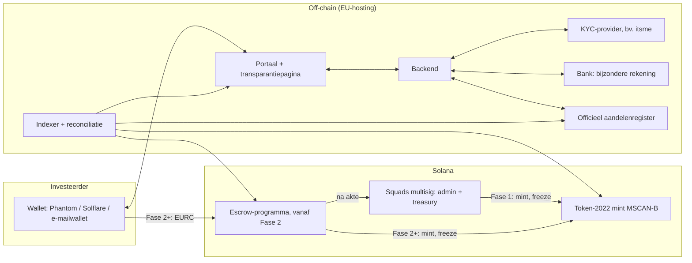
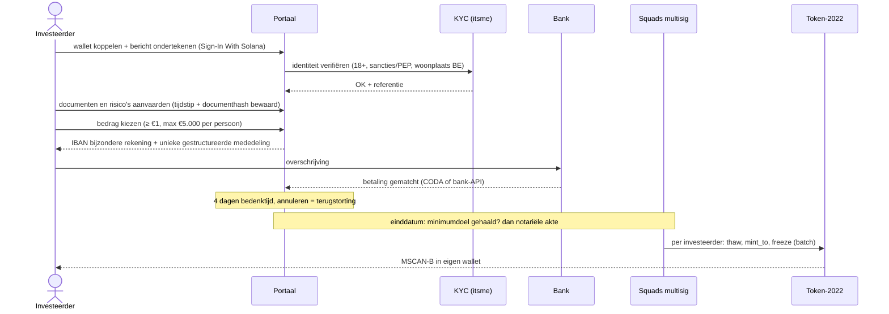

# Technisch ontwerp (v0.1, concept)

Hoort bij [plan.md](plan.md). Dit document is bedoeld voor ontwikkelaars, de auditor en de advocaat: het beschrijft wat er on-chain en off-chain gebeurt, en welke regels in code afgedwongen worden.

Uitgangspunt: **Optie A** uit het plan (rechtstreekse B-aandelen, token = digitale weergave, het officiële register blijft juridisch leidend). Bij Optie B (stichting en certificaten) blijft de techniek dezelfde; enkel de juridische betekenis van de token verandert.

---

## 1. Componenten



---

## 2. De token (Token-2022)

| Eigenschap | Waarde | Waarom |
|---|---|---|
| Programma | Token-2022 (SPL Token Extensions) | Geauditeerde standaard, ondersteunt de extensies hieronder |
| Decimalen | 0 | 1 token = 1 aandeel, geen fracties |
| Max aantal | 49.000.000 | 49% van 100.000.000 aandelen. Fase 1: bewaakt door de multisig en publieke reconciliatie. Vanaf Fase 2: afgedwongen in de code van het escrow-programma |
| Mint authority | Fase 1: Squads-vault. Fase 2+: PDA van het escrow-programma. Na Fase 3: `None` (onomkeerbaar) | Geen stille bijmunting mogelijk |
| Freeze authority | Fase 1: Squads-vault. Fase 2+: PDA van het escrow-programma (met admin-instructie voor herstel) | Nodig voor uitgifte in bevroren accounts en voor herstel |

**Extensies, allemaal bij het aanmaken in te stellen** (achteraf toevoegen kan niet):

- `MetadataPointer` + `TokenMetadata`: naam "Marketingscan B-aandeel", symbool `MSCAN-B`, `uri` naar een JSON met logo en documentlinks. Extra velden: ondernemingsnummer, aandelenklasse `B`, hash van de uitgiftevoorwaarden. Update authority: multisig.
- `DefaultAccountState = Frozen`: elk nieuw token-account is bevroren. Overdrachten kunnen pas na een gecontroleerde procedure.
- `PermanentDelegate = multisig`: herstel bij een verloren wallet, een erfenis of een rechterlijke beslissing. Elke inzet krijgt een publieke log met een hash van de reden.
- `TransferHook` met `program_id = None` en authority = multisig: nu niets, maar zo kan er in Fase 3 een hook komen voor overdrachten tussen geverifieerde wallets, zonder een nieuwe token te moeten maken.
- Optioneel: `ScaledUiAmount` (voor latere aandelensplitsingen) en `Pausable` (noodrem). Beslissen vóór het aanmaken.

Let op: een permanent delegate kan geen tokens verplaatsen uit een bevroren account. Herstel = `thaw` (freeze authority), dan `transfer_checked` (permanent delegate), dan `freeze`, in één transactie.

---

## 3. Fase 1: lean, zonder eigen smart contract

Enkel bestaande, geauditeerde programma's: Token-2022, Associated Token Account en Squads v4.

### 3.1 Inschrijven



- **Aantal aandelen:** `aandelen = floor(bedrag / prijs)`, en de investeerder betaalt `aandelen x prijs`. Bij €0,01 per aandeel geeft €1 exact 100 aandelen. Bij een prijs die niet mooi deelt, toont het portaal bv. "€0,99 voor 33 aandelen".
- **Rent sponsoren:** Marketingscan betaalt het aanmaken van het token-account (ca. 0,002 SOL), zodat €1 echt €1 is.
- **Uitgifte in batches** via Squads (meerdere instructies per transactie, meerdere transacties per batch). Na elke batch vergelijkt de reconciliatie het register met de on-chain saldi.

### 3.2 Overdracht (Fase 1 en 2)

1. Verkoper en koper melden de overdracht via het portaal (de koper is geverifieerd).
2. Controle volgens de statuten (bv. goedkeuringsclausule) en inschrijving in het register.
3. Multisig: `thaw` verkoper en koper, `transfer_checked` via de permanent delegate, `freeze` beide. Eén transactie, publieke log.

### 3.3 Herstel (verloren wallet, erfenis)

Opnieuw identiteit verifiëren, nieuwe wallet koppelen, en dan dezelfde multisig-transactie als bij een overdracht, met een hash van het bewijsstuk (bv. attest van erfopvolging) in de log.

---

## 4. Fase 2+: escrow-programma `msc_offering` (Anchor)

### 4.1 Accounts

| Account | Seeds | Belangrijkste velden |
|---|---|---|
| `Offering` | `["offering", share_mint]` | `admin` (Squads-vault), `kyc_authority`, `share_mint`, `payment_mint` (EURC), `treasury`, `founder_shares` (51.000.000), `max_investor_shares` (49.000.000), `shares_issued`, `shares_reserved`, `phase_count`, `valuation_count`, `minting_closed` |
| `Phase` | `["phase", offering, id]` | `price_per_share`, `min_purchase_amount`, `shares_for_sale` (hard cap), `soft_cap_shares`, `max_amount_per_person`, `start_ts`, `end_ts`, `cooling_off_secs`, `issuance_deadline_ts`, `shares_subscribed`, `amount_escrowed`, `status`, `terms_hash`, `deed_hash` |
| `Identity` | `["identity", offering, identity_hash]` | `wallet`: maakt "1 persoon = 1 wallet" afdwingbaar |
| `Investor` | `["investor", offering, wallet]` | `identity_hash`, `kyc_expires_ts`, `country`, `status` |
| `Subscription` | `["subscription", phase, wallet]` | `shares`, `amount_paid`, `created_ts`, `status` (Active, Cancelled, Refunded, Claimed) |
| `Valuation` | `["valuation", offering, seq]` | `price_per_share`, `report_hash`, `effective_date`, `published_ts` |
| Escrow-vault | `["vault", phase]` | Token-account van `payment_mint`, authority = PDA |

Bedragen in basiseenheden van EURC (6 decimalen): €1 = `1_000_000`, €0,01 per aandeel = `10_000`. Alle rekenwerk met `checked_*`.

`identity_hash` = HMAC-SHA256 met een geheime sleutel over de KYC-referentie. Een gewone hash van een rijksregisternummer is te raden (weinig mogelijke waarden); met een geheime sleutel niet. On-chain staan geen persoonsgegevens.

### 4.2 Instructies

| Instructie | Wie tekent | Regels |
|---|---|---|
| `initialize_offering` | admin | `shares_issued` = huidige supply uit Fase 1; mint en freeze authority daarna door de multisig overgedragen aan de PDA |
| `create_phase` | admin | prijs > 0; soft cap ≤ hard cap; `start < end`; `shares_issued + shares_reserved + hard cap ≤ 49.000.000`; geen overlappende fase; `minting_closed == false` |
| `register_investor` | kyc_authority **en** de investeerderswallet | maakt `Identity` + `Investor`; de wallet tekent mee, zodat de KYC-sleutel geen vreemde wallets kan koppelen |
| `revoke_investor` / `update_kyc` | kyc_authority of admin | bv. bij verlopen KYC of sancties |
| `subscribe(shares)` | investeerder | KYC geldig; `start ≤ nu < end`; `shares x prijs ≥ min_purchase_amount`; `≤ max_amount_per_person`; hard cap niet overschreden; één inschrijving per fase; EURC naar de vault |
| `cancel_subscription` | investeerder | binnen `cooling_off_secs` na `created_ts` en fase nog niet afgesloten; volledige terugbetaling |
| `finalize_phase` | iedereen | pas na `end_ts + cooling_off_secs`; `shares_subscribed ≥ soft_cap_shares` ? `Succeeded` : `Failed` |
| `claim_refund` | iedereen (geld gaat altijd naar de inschrijver) | fase `Failed` |
| `confirm_issuance(deed_hash)` | admin | fase `Succeeded` en `nu ≤ issuance_deadline_ts`; escrow naar treasury; `shares_reserved` wordt `shares_issued` |
| `expire_issuance` | iedereen | `Succeeded` maar geen akte voor de deadline: fase wordt `Failed`, iedereen kan terugclaimen. **Geld kan nooit eeuwig vastzitten.** |
| `claim_shares` | iedereen (tokens gaan altijd naar de inschrijver) | fase `Issued`; CPI: `thaw`, `mint_to`, `freeze` |
| `publish_valuation` | admin | legt prijs per aandeel en rapporthash vast |
| `admin_set_frozen(account, reason_hash)` | admin | voor overdracht en herstel; altijd met event |
| `close_minting` | admin | geen fase open; mint authority wordt `None`; onomkeerbaar |
| `propose_admin` / `accept_admin` | admin / nieuwe admin | wissel in twee stappen |

Elke instructie zendt een **event** uit. De indexer maakt daar de publieke transparantiepagina en de reconciliatie mee.

### 4.3 Invarianten (voor tests en audit)

1. `shares_issued + shares_reserved ≤ max_investor_shares` (49.000.000), altijd.
2. Voor een fase in `Open` of `Succeeded`: saldo van de vault = `amount_escrowed` = som van `amount_paid` van de actieve inschrijvingen.
3. `share_mint.supply ≤ shares_issued`. Gelijk zodra iedereen geclaimd heeft.
4. `amount_paid == shares x price_per_share` voor elke inschrijving.
5. Eén identiteit hoort bij max één wallet, en omgekeerd.
6. Geld verlaat de vault enkel via (a) `cancel_subscription` naar de inschrijver, (b) `claim_refund` naar de inschrijver, of (c) `confirm_issuance` naar de treasury.
7. Na `close_minting` is de mint authority `None`.

### 4.4 Open juridische afhankelijkheid

Een inbreng in geld moet bij een uitgifte van aandelen normaal op een bijzondere bankrekening staan vóór de notariële akte. Of en hoe EURC in de escrow daarvoor kan tellen, of eerst omgezet moet worden naar euro, beslist de notaris. Het ontwerp hierboven laat beide toe, maar **EURC wordt pas geactiveerd na schriftelijk akkoord van de notaris en de advocaat.**

---

## 5. Off-chain

- **Portaal en transparantiepagina:** web (bv. Next.js), Solana wallet-standard (Phantom, Solflare, Backpack) en een e-mailwallet voor wie geen crypto heeft. Inloggen via Sign-In With Solana.
- **Backend:** KYC-webhooks, inschrijvingen, bankreconciliatie (gestructureerde mededeling), export naar het aandelenregister, e-mails, tax-shelterattesten.
- **Indexer:** leest token- en programma-events en publiceert een openbare JSON-API plus een dagelijks reconciliatierapport (register versus on-chain), waarvan de hash on-chain of publiek gepubliceerd wordt.
- **Data:** persoonsgegevens enkel off-chain, in de EU, met een DPIA (GDPR).

---

## 6. Beveiliging

- Multisig-leden op **hardwarewallets**. 2 van 3 (later 3 van 5), met een onafhankelijke medeondertekenaar.
- `kyc_authority` is een beperkte sleutel: kan enkel investeerders registreren of intrekken, nooit geld of tokens bewegen.
- Upgrade authority van het programma = multisig met een **tijdsslot** (aankondiging minstens 7 dagen vooraf). Na Fase 3: onveranderbaar.
- **Externe audit** met publiek rapport, plus een bug bounty.
- **Verified build:** iedereen kan nagaan dat de code on-chain identiek is aan de broncode op GitHub.
- **Monitoring:** alarm bij elke uitgaande transactie uit een vault, elke wijziging van een authority en elke inzet van de permanent delegate.

---

## 7. Bouwvolgorde

| Sprint | Inhoud | Resultaat |
|---|---|---|
| 1 | Token aanmaken met alle extensies (script), Squads op devnet, uitgifte-batchscript | MSCAN-B op devnet in een testwallet |
| 2 | Portaal: wallet koppelen, saldo, percentage, indicatieve waarde, documenten; publieke transparantiepagina | Klikbare versie op devnet |
| 3 | KYC-sandbox, inschrijfflow, bankreconciliatie (test), registerexport | Volledige droogloop met testgebruikers |
| Juridisch groen licht | Mainnet Fase 1 | Eerste echte inschrijvingen |
| Voorbereiding Fase 2 | Escrow-programma (Anchor) + tests (LiteSVM) + audit + verified build | Klaar voor EURC |

Voorgestelde mappenstructuur:

```
docs/                  plan en ontwerp
app/                   portaal + transparantiepagina
scripts/               token aanmaken, uitgifte-batches, reconciliatie
programs/msc-offering/ escrow-programma (vanaf Fase 2)
tests/
```
