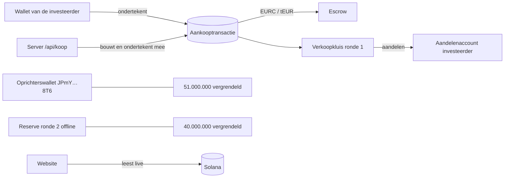

# Technisch ontwerp (v0.2, werkt op testnet)

Hoort bij [plan.md](plan.md). Voor ontwikkelaars, de auditor en de advocaat: wat er on-chain en off-chain gebeurt, en welke regels waar afgedwongen worden.

---

## 1. Overzicht

| Onderdeel | Waar | Wat |
|---|---|---|
| Website | `web/` (React, Vite, TypeScript) | overzicht, investeren, portefeuille, transparantie, privacy |
| Aankoop voorbereiden | `api/koop.js` → `server/purchase.js` | bouwt de atomaire aankooptransactie en ondertekent mee |
| Testgeld | `api/testgeld.js` → `server/faucet.js` | 50 tEUR per keer, max 100 tEUR saldo, nooit op mainnet |
| Wachtlijst | `api/waitlist.js` | e-mail met toestemming naar Supabase |
| Rekenregels | `shared/offering.js`, `shared/aanbod.json` | gedeeld door site, server en scripts |
| Adressen | `shared/deployments/<netwerk>.json` | aangemaakt door het setupscript |
| Scripts | `scripts/solana/` | opzetten, demo-aankopen, terugbetalen, vrijgeven |

---

## 2. De token

| Eigenschap | Waarde |
|---|---|
| Programma | Token-2022 |
| Decimalen | 0 (1 token = 1 aandeel) |
| Voorraad | 100.000.000, muntrecht ingetrokken (`mintAuthority = null`) |
| Extensies | `MetadataPointer` + `TokenMetadata` (naam, symbool, link, totaal, website), `DefaultAccountState = Frozen`, `PermanentDelegate` = herstelsleutel |
| Freeze authority | serversleutel (nodig om bij aankoop even te ontdooien) |

**Verdeling bij de start** (`scripts/solana/setup.mjs`):

| Account | Eigenaar | Aantal | Toestand |
|---|---|---|---|
| Oprichter | `JPmYxhBGqt9GMe6kfozUce3EyQRAoQZD1hbLGWJR8T6` | 51.000.000 | bevroren |
| Verkoopkluis ronde 1 | serversleutel | 9.000.000 | ontdooid |
| Reserve ronde 2 | reservesleutel (offline) | 40.000.000 | bevroren |

**Sleutels** (`.keys/<netwerk>/`, nooit in git):

| Sleutel | Kan | Kan niet | Bewaren |
|---|---|---|---|
| `authority.json` (server) | kosten betalen, verkopen uit kluis 1, accounts (ont)vriezen, escrow beheren | aandelen bijmaken, aandelen van investeerders verplaatsen, reserve 2 gebruiken | omgevingsvariabele `SALE_AUTHORITY_SECRET` |
| `reserve.json` | reserve ronde 2 vrijmaken (samen met de server) | alleen niets | offline |
| `herstel.json` (permanent delegate) | aandelen van een verloren wallet overzetten, terugbetalingen | geld verplaatsen, bijmaken | offline |

---

## 3. De aankoop (atomair)

`POST /api/koop { wallet, bedrag, ronde }`

1. Server controleert met `checkPurchase`: ronde open, minimum €1, maximum per persoon, genoeg aandelen in de kluis, genoeg saldo.
2. Server bouwt één transactie:
   1. aandelenaccount van de koper aanmaken als het niet bestaat (server betaalt de huur);
   2. dat account ontdooien;
   3. betaling: koper → escrow (`transferChecked`, ondertekend door de koper);
   4. aandelen: kluis → koper (`transferChecked`, ondertekend door de server);
   5. account opnieuw bevriezen;
   6. memo: "Marketing Scan Ronde 1: 200 MSCAN voor 1,00 tEUR".
3. Server is betaler van de kosten en ondertekent gedeeltelijk. De koper ziet in de eigen wallet exact wat er gebeurt en ondertekent.
4. De site verstuurt en wacht op bevestiging (zonder websockets).

Gevolgen: de koper betaalt enkel bij ontvangst van de aandelen; de koper heeft geen SOL nodig; een gewijzigde transactie is ongeldig, want de serverhandtekening klopt dan niet meer (getest).

---

## 4. Einde van een ronde

| Situatie | Script | Wat het doet |
|---|---|---|
| Minimumdoel gehaald | `vrijgeven.mjs --naar <treasury>` | escrow naar de treasury (weigert zolang het doel niet gehaald is) |
| Minimumdoel niet gehaald | `terugbetalen.mjs --uitvoeren` | per koper: volledige inleg terug en aandelen terug naar de kluis, met memo |

Beide scripts tonen eerst een droogtest. Elke stap is een publieke transactie.

---

## 5. De website

- **Inloggen:** Wallet Standard via `@solana/wallet-adapter-react` (Phantom, Solflare, Backpack, ...), met een eigen Nederlandstalig venster. Op gsm: knop om de site in de Phantom- of Solflare-app te openen. Op testnet uitleg om de wallet op Devnet te zetten.
- **Live gegevens:** `web/src/lib/chain.ts` leest token, kluizen, escrow, aantal investeerders (`getProgramAccounts` met filter op de token) en aankopen (geschiedenis van escrow of aandelenaccount). Ververst elke 15 tot 30 seconden zolang de pagina zichtbaar is.
- **Waarde:** aantal aandelen × prijs van de laatste gestarte ronde, met bron en de vermelding dat het geen verkoopprijs is.
- **Netwerk:** `VITE_SOLANA_NETWORK` (standaard `devnet`), optioneel `VITE_SOLANA_RPC_URL`. Zonder deployment toont de site nette "nog niet geactiveerd"-meldingen.

---

## 6. Testen

| Soort | Commando | Wat |
|---|---|---|
| Unit en API | `npm test` | rekenregels, API-validatie, X-compliance, wachtlijst (77 tests) |
| Keten | `SOLANA_E2E_DEPLOYMENT=… SOLANA_E2E_AUTHORITY=… node --test test/solana-e2e.test.js` | 7 tests op een echte (lokale) Solana-keten |
| Browser | `node scripts/e2e/ui-koop.mjs` | inloggen met testwallet, testgeld, aankoop, portefeuille, schermafbeeldingen |
| Typecontrole | `npm run typecheck` | TypeScript van de site |

Lokale keten: `solana-test-validator`, dan `node scripts/solana/setup.mjs --network localnet` en eventueel `demo-aankopen.mjs`.

---

## 7. Op het testnet zetten (devnet)

1. Stuur 2 tot 5 devnet-SOL naar de serversleutel (via https://faucet.solana.com).
2. `node scripts/solana/setup.mjs --network devnet` → schrijft `shared/deployments/devnet.json` (committen).
3. Optioneel: `node scripts/solana/demo-aankopen.mjs --network devnet`.
4. Vercel: omgevingsvariabelen `SOLANA_NETWORK=devnet`, `SALE_AUTHORITY_SECRET=<inhoud van .keys/devnet/authority.json>`, en voor de wachtlijst `SUPABASE_URL` en `SUPABASE_SECRET_KEY`.

---

## 8. Naar mainnet (pas na juridisch groen licht)

- Betaalmunt EURC in plaats van tEUR (`paymentMint` in de deployment), testgeld uit.
- Treasury als Squads-multisig (2 van 3, met een onafhankelijke derde).
- Verkoop via een geaudit escrow-programma, zodat terugbetalen bij een gemist minimumdoel niet van één serversleutel afhangt.
- KYC vóór de aankoop (bv. itsme), met de limiet per geverifieerde persoon.
- Eigen RPC-provider (bv. Helius) en een snelheidslimiet op de API.
- Externe audit, verified build, monitoring op elke uitgaande transactie.
