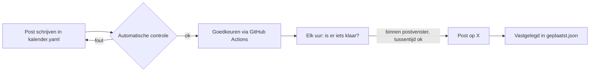

# Automatische promotie via X

Dit systeem plaatst posts op X volgens een vaste kalender, met controles die in de code zitten. Het doel: professioneel en regelmatig communiceren over Marketing Scan en de community-ronde, zonder dat er ooit iets online gaat dat juridisch fout zit.

## Wat het automatisch doet

- **Plant en post** op het juiste moment, enkel tussen 08:00 en 21:00 (Brusselse tijd), met minstens 2 uur tussen twee posts en max 2 posts per dag.
- **Controleert elke post** vóór goedkeuring en opnieuw vóór plaatsing:
  - geen beloftes: "gegarandeerd", "zeker rendement", "verdubbelt", "10x", percentages rendement, ...
  - geen tijdsdruk: "laatste kans", "nu of nooit", ...
  - geen crypto-hype: "to the moon", "presale", "airdrop", cashtags zoals $MSCAN, ...
  - **zolang er geen aanbod is:** geen oproep om te investeren, en elke post over de ronde vermeldt letterlijk "Nog geen aanbod" (en bij categorie `ronde` ook "Investeren houdt risico's in");
  - enkel links naar toegelaten domeinen, max 280 tekens zoals X ze telt, max 2 hashtags.
- **Goedkeuring gekoppeld aan de tekst:** wie goedkeurt, wordt vastgelegd met een vingerafdruk van de exacte tekst. Wordt de tekst nadien aangepast, dan vervalt de goedkeuring automatisch.
- **Wekelijkse transparantie-update** (elke maandag): vult een sjabloon met de cijfers uit `marketing/x/data/cijfers.json` (en, als Supabase gekoppeld is, het echte aantal op de wachtlijst). Posten gebeurt enkel als die cijfers de voorbije 8 dagen bijgewerkt zijn. Zo komen er nooit verouderde cijfers online.
- **Publiek logboek:** elke geplaatste post komt met link en tijdstip in `marketing/x/state/geplaatst.json`.

De controles vangen de klassieke fouten op. Ze vervangen geen juridisch nazicht. Daarom is er een extra slot:

- **Productposts** (over de gratis scan) kunnen meteen, na goedkeuring.
- **Posts over de ronde** (categorieën `ronde`, `uitleg`, `transparantie`, of elke post die over investeren gaat) blijven op "wacht op juridisch nazicht" staan tot je in `marketing/x/config.json` `"legalReviewDone": true` zet. Doe dat pas nadat je advocaat de site en die posts heeft nagelezen.

## Eenmalige installatie

### 1. X API

1. Maak op [developer.x.com](https://developer.x.com) een project en een app aan met het account van Marketing Scan.
2. Zet de app-rechten op **Read and Write**.
3. Laad krediet op (pay-per-use). Richtprijs oktober 2026: $0,015 per post, $0,20 per post met een link. De kalender van 5 weken kost zo ongeveer $1,30.
4. Genereer de **API Key en Secret** en daarna, met het Marketing Scan-account, de **Access Token en Secret** (OAuth 1.0a, user context).

### 2. GitHub

Op GitHub: **Settings > Secrets and variables > Actions**.

| Soort | Naam | Waarde |
|---|---|---|
| Secret | `X_API_KEY` | API Key |
| Secret | `X_API_SECRET` | API Key Secret |
| Secret | `X_ACCESS_TOKEN` | Access Token |
| Secret | `X_ACCESS_SECRET` | Access Token Secret |
| Secret (optioneel) | `SUPABASE_URL`, `SUPABASE_SECRET_KEY` | voor het live aantal op de wachtlijst |
| Variable | `X_POSTING_ENABLED` | `true` om echt te posten. Zolang dit ontbreekt: droogtest. |

Het automatisch posten draait enkel vanaf de hoofdbranch (`master`). Merge deze branch dus eerst.

## Dagelijks gebruik

1. **Post schrijven:** open `marketing/x/kalender.yaml` op GitHub (potloodje), voeg een post toe en bewaar. De workflow "X: controle" meldt meteen of de post door de controle komt.
2. **Goedkeuren:** Actions > **X: post goedkeuren** > Run workflow > id invullen > goedkeuren.
3. **Planning bekijken:** lokaal `npm run x:plan`, of de logs van "X: automatisch posten" (elke run toont wat klaar is en waarom iets wacht).
4. **Elke week:** werk `marketing/x/data/cijfers.json` bij (datum `bijgewerkt`, juridische stand, volgende stap) en keur het sjabloon `transparantie-wekelijks` één keer goed.

### Noodstop

- Alles meteen stilleggen: zet de variabele `X_POSTING_ENABLED` op `false`, of zet `"paused": true` in `marketing/x/config.json`.
- Eén post tegenhouden: Actions > X: post goedkeuren > actie **intrekken**.

## Wanneer het aanbod live gaat

Pas als de documenten gepubliceerd zijn en je advocaat akkoord is:

1. In `marketing/x/config.json`: `offer.status` op `live`, `documentsUrl` invullen, en bij de de-minimisregel `deMinimisNotice` (bv. "max €500.000, max €5.000 per persoon").
2. Vanaf dan eist de controle in elke post over de ronde: "Je kan je volledige inleg verliezen", de link naar de documenten ({docs}) en de de-minimisvermelding.
3. Pas de site aan: de wachtlijst wordt een inschrijving, met dezelfde vermeldingen.

## De website

- De site staat in `web/` (React) en wordt gebouwd met `npm run build`. Hosting: Vercel (`vercel.json`, met strikte beveiligingsheaders).
- De wachtlijst (`api/waitlist.js`) bewaart enkel e-mail, taal en tijdstip van toestemming in Supabase (tabel uit `supabase/migrations/`). Zet in Vercel `SUPABASE_URL` en `SUPABASE_SECRET_KEY`.
- Domein: voorstel `community.marketingscan.be`. Pas het aan in `web/index.html` (meta-tags) en `marketing/x/config.json` als je een ander adres kiest.
- **Voor de productie-deploy:** vul `shared/bedrijf.json` in (vennootschap, adres, ondernemingsnummer, privacy-e-mail). Een productie-build op Vercel faalt zolang die ontbreken (`npm run site:check`).
- De deelafbeelding voor X en het tokenlogo maak je opnieuw met `npm run site:og` (vereist Playwright).
