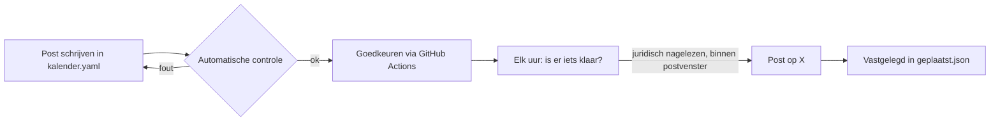

# Automatische promotie via X

Dit systeem plaatst posts op X volgens een vaste kalender, met controles die in de code zitten. Het doel: regelmatig en professioneel communiceren over Marketing Scan en Marketing Scan Genesis, zonder dat er ooit iets online gaat dat op een investering lijkt.

De posts zijn **standaard in het Engels**: zo bereiken we het crypto-publiek op X. Een post kan ook in het Nederlands, bijvoorbeeld voor Belgische kmo's (zie [Talen](#talen)).



## Waarom zo streng

Marketing Scan Genesis is een voorverkoop van levenslange abonnementen (Genesis Pass, Genesis Agency en Supporter, zie `shared/genesis.json`). Het is **geen investering**: je krijgt geen aandelen, geen rendement, en de passes zijn soulbound, dus niet verhandelbaar. Elke post moet dat ook zo laten klinken. De controle blokkeert daarom alles wat op een investering, een effect of crypto-speculatie lijkt.

## Talen

Elke post heeft een taal: Engels (`en`) of Nederlands (`nl`).

- **Standaard Engels.** `"defaultLang": "en"` in `marketing/x/config.json` geldt voor elke post zonder taal. Ontbreekt die sleutel, dan is het ook Engels.
- **Nederlandse post:** zet `lang: nl` bij de post in `kalender.yaml`. Hou het Nederlands voor posts die echt op Belgische kmo's mikken (bv. productposts over de gratis scan).
- **Verplichte vermeldingen in de taal van de post:** Engels "Not an investment" en "Not on sale yet", Nederlands "Geen investering" en "Nog geen verkoop". Een Engelse post met enkel "Geen investering" wordt dus geblokkeerd.
- **Verboden woorden gelden altijd in beide talen**, ongeacht de taal van de post. Een Engels woord in een Nederlandse post (of omgekeerd) glipt er dus niet door.
- **Links in de taal van de post:** `{site}`, `{genesis}`, `{transparantie}` en `{voorwaarden}` krijgen automatisch `?lang=en` of `?lang=nl`, zodat de site meteen in die taal opent. Heeft de link al een `?`, dan blijft hij zoals hij is. `{scan}` (marketingscan.be) krijgt niets. Een link telt op X altijd als 23 tekens, met of zonder `?lang`.

```yaml
  - id: 2026-11-03-google-bedrijfsprofiel
    moment: 2026-11-03T10:00:00+01:00
    categorie: product
    status: concept
    lang: nl          # weglaten = Engels
    tekst: |-
      Je Google Bedrijfsprofiel is vaak het eerste wat een klant van je ziet. ...
```

De meegeleverde kalender telt 14 posts: 12 in het Engels (om 15:00, dan lezen Europa en de Amerikaanse oostkust allebei mee) en 2 Nederlandse productposts (om 10:00).

## Categorieën

| Categorie | Waarover | Verplicht |
|---|---|---|
| `product` | de scan zelf | mag niet over Genesis, passes, wallets of de voorverkoop gaan |
| `genesis` | de Genesis Pass, de prijsladder, de Genesis-muur, de roadmap | "Not an investment" + "Not on sale yet" (Nederlands: "Geen investering" + "Nog geen verkoop") |
| `uitleg` | hoe het werkt: wallet, soulbound, geld terug, de demo | idem |
| `transparantie` | cijfers en stand van zaken | idem |
| `verkoop` | directe koopoproepen | kan pas als de verkoop live is, met link naar de voorwaarden |

Een post in een andere categorie die toch Genesis-woorden bevat (pass, wallet, Solana, lifetime, levenslang, refund, devnet, early access, ...) krijgt dezelfde verplichtingen en hetzelfde juridisch slot.

## Wat de controle blokkeert

Elke post wordt gecontroleerd bij het schrijven (workflow "Controle"), bij het goedkeuren en opnieuw vlak voor het posten.

- **Investeringstaal**, in het Nederlands en het Engels: investeren, investering, belegging, invest, investor; aandelen, shares, shareholder, equity, mede-eigenaar, co-owner, "own a piece of", "a share in", "stake in"; rendement, return(s), ROI, APY, APR, yield, staking, revenue share, winst, profit, dividend; waardering, valuation, "meer waard", "stijgt in waarde", "worth more", "going up in value", "value goes up", upside, market cap, price target, skyrocket; doorverkopen, resell, resale, flip, trade, tradable, transferable, "sell it", verhandelbaar, secondary market, floor price, OpenSea, speculatie; beursnotering, "listed on", exchange, DEX.
- **Beloftes:** gegarandeerd, guarantee(d), "zonder risico", risk-free, "zero risk", "nothing to lose", passief inkomen, passive income, "get rich", "financial freedom", "10x", "100x", "double your money", "x keer je geld", "8% a year". Let op: ook "money-back guarantee" wordt geblokkeerd. Zeg "one-click refund" of "14 days to get your money back".
- **Crypto-hype en crypto-verkooptermen:** moon, lambo, pump, wagmi, LFG, bullish, ape in, hodl, diamond hands, "hidden gem"; presale, pre-sale, ICO, IDO, TGE, token sale, token launch, fair launch, free mint, airdrop, whitelist, allowlist, WL, public/private sale; cashtags zoals `$MSGEN`. Het woord "voorverkoop" mag in het Nederlands wel. **In het Engels nooit "presale"** (klinkt als een token sale): zeg "early access" of "founding members".
- **Tijdsdruk:** laatste kans, nu of nooit, fomo, haast je, op is op, beperkte tijd, last chance, now or never, hurry, "don't miss", "limited time", "act now", "only 12 left", "selling fast", "while supplies last", ...
- **Ontkennen mag, maar enkel vlak ervoor** (hooguit een lidwoord ertussen). Nederlands: geen, niet, nooit, zonder, ... Engels: not, no, never, without, isn't, "is not", zero, don't, can't, en "non-" ervoor. Toegestaan: "Geen investering", "niet verhandelbaar", "geen aandelen", "Not an investment", "no shares", "no returns", "not transferable", "non-transferable", "no speculation". Blijft geblokkeerd: "Geen gedoe, wel rendement" en "Not an investment, but huge returns".
- **Feiten over de prijsladder mogen wel:** "De prijs stijgt per 50 verkochte passes", "Vroeger instappen is goedkoper", "The price rises every 50 passes", "Earlier is cheaper" en "Your number sets your price" gaan over de prijs die je betaalt, niet over een doorverkoopwaarde.
- **Zolang de verkoop niet live is:** elke Genesis-post vermeldt letterlijk "Not on sale yet" (Nederlands: "Nog geen verkoop"), en koopoproepen zijn verboden in beide talen: "koop nu", "claim je pass", "bestel nu", "word supporter", "de voorverkoop is open", "buy now", "mint yours today", "claim your pass", "secure your spot", "lock in your price", "become a supporter", "join now", "get in early", "the sale is open", "early access is live", ... De demo uitleggen ("mint a test pass on devnet") is geen koopoproep.
- **Altijd:** enkel links naar toegelaten domeinen, max 280 tekens zoals X ze telt (een link telt als 23), max 2 hashtags. Passnummers zoals `#001` tellen niet als hashtag.

De controles vangen de klassieke fouten op. Ze vervangen geen juridisch nazicht.

## Twee sloten

1. **Juridisch nazicht.** Productposts kunnen meteen na goedkeuring. Alle andere posts (en elke post met Genesis-woorden) blijven op "wacht op juridisch nazicht" staan tot `offer.legalReviewDone` op `true` staat. Doe dat pas als de rechtsvorm vastligt en de site en de posts nagelezen zijn.
2. **Verkoop.** De verkoop is pas "live" als `offer.verkoopActief` **en** `offer.legalReviewDone` allebei `true` zijn. Vanaf dan:
   - kan categorie `verkoop`, en enkel daar mogen koopoproepen staan;
   - moet elke verkooppost een link naar de voorwaarden bevatten (`{voorwaarden}`);
   - is "Nog geen verkoop" niet meer verplicht: de controle waarschuwt waar het nog staat.

## Instellingen (`marketing/x/config.json`)

| Sleutel | Nu | Betekenis |
|---|---|---|
| `offer.verkoopActief` | `false` | De verkoop is open. Hou dit gelijk met `verkoopActief` in `shared/genesis.json`. |
| `offer.legalReviewDone` | `false` | Site en posts zijn juridisch nagelezen. |
| `defaultLang` | `"en"` | Taal van elke post zonder `lang`: `en` of `nl`. |
| `offer.required` | `{ "en": "Not an investment", "nl": "Geen investering" }` | Verplichte vermelding in elke Genesis-post, per taal. |
| `offer.noticeWhenNotLive` | `{ "en": "Not on sale yet", "nl": "Nog geen verkoop" }` | Verplichte vermelding zolang de verkoop niet live is, per taal. |
| `offer.voorwaardenUrl` | `https://community.marketingscan.be/voorwaarden` | Link voor `{voorwaarden}`, verplicht in verkoopposts. |
| `paused` | `false` | `true` zet alles in droogtest. |
| `links.site`, `links.scan` | | Basisadressen. `{genesis}` en `{transparantie}` volgen uit `links.site`. |
| `links.allowedDomains` | | Domeinen waarnaar een post mag linken. |

De oude vorm met een gewone tekst (`"required": "Geen investering"`) werkt nog: die tekst geldt dan voor de Nederlandse posts, en de Engelse posts gebruiken de vaste standaardteksten "Not an investment" en "Not on sale yet". Ontbreekt een taal of een sleutel, dan gelden ook die standaardteksten: een vergeten sleutel schakelt nooit een vermelding uit.

Placeholders in de kalender: `{site}`, `{scan}`, `{genesis}` (= `{site}/genesis`), `{transparantie}` (= `{site}/transparantie`) en `{voorwaarden}`. Alle behalve `{scan}` krijgen `?lang=` in de taal van de post, bv. `https://community.marketingscan.be/genesis?lang=en`.

## Wekelijkse transparantie-update

Elke maandag vult het sjabloon `transparantie-wekelijks` de cijfers in uit `marketing/x/data/cijfers.json`.

Het sjabloon heeft een Engelse en een Nederlandse tekst (`tekst.en` en `tekst.nl`). `lang` kiest welke gepost wordt, nu `en`. Beide teksten gaan door de controle, ook de tekst die niet gepost wordt. Wissel je van taal, keur het sjabloon dan opnieuw goed: de goedkeuring hoort bij de gekozen tekst. De cijfers volgen de notatie van de taal: Engels `1,234` en `€12,345.50`, Nederlands `1.234` en `€12.345,50`.

| Veld | Variabele | Opmerking |
|---|---|---|
| `bijgewerkt` | | Datum van je laatste update. Ouder dan 8 dagen: de post blijft geblokkeerd. |
| `passesGeclaimd` | `{passes}` | 0 tot 250 |
| `agencyGeclaimd` | `{agency}` | 0 tot 25 |
| `supporters` | `{supporters}` | |
| `opgehaaldEur` | `{opgehaald}` | in euro, richting het doel van €50.000 |
| `wekelijkseGebruikers` | `{gebruikers}` | |
| `wachtlijst` | `{wachtlijst}` | optioneel; met Supabase-sleutels wordt het echte aantal opgehaald |
| `stand` | `{stand}` | korte stand van zaken in eigen woorden, per taal: `{ "en": "...", "nl": "..." }` |

Een ontbrekend of onmogelijk cijfer (bv. 251 passes) blokkeert de post. Ook een `stand` zonder tekst in de taal van het sjabloon blokkeert de post. Een gewone tekst als `stand` telt als Nederlands, dus voor de Engelse update heb je `stand.en` nodig. De vrije tekst in `stand` gaat door dezelfde controle als elke post. Tel enkel echte verkoop mee, geen testnet.

## Eenmalige installatie

### 1. X API

1. Maak op [developer.x.com](https://developer.x.com) een project en een app aan met het account van Marketing Scan.
2. Zet de app-rechten op **Read and Write**.
3. Laad krediet op (pay-per-use). Richtprijs oktober 2026: $0,015 per post, $0,20 per post met een link. De kalender (14 posts over 7 weken) kost zo ongeveer $2,25, plus $0,20 per wekelijkse update.
4. Genereer de **API Key en Secret** en daarna, met het Marketing Scan-account, de **Access Token en Secret** (OAuth 1.0a, user context).

### 2. GitHub

Op GitHub: **Settings > Secrets and variables > Actions**.

| Soort | Naam | Waarde |
|---|---|---|
| Secret | `X_API_KEY` | API Key |
| Secret | `X_API_SECRET` | API Key Secret |
| Secret | `X_ACCESS_TOKEN` | Access Token |
| Secret | `X_ACCESS_SECRET` | Access Token Secret |
| Secret (optioneel) | `SUPABASE_URL`, `SUPABASE_SECRET_KEY` | voor het live aantal op de wachtlijst |
| Variable | `X_POSTING_ENABLED` | `true` om echt te posten. Zolang dit ontbreekt: droogtest. |

Het automatisch posten draait enkel vanaf de hoofdbranch (`master`). Merge deze branch dus eerst.

## Dagelijks gebruik

1. **Post schrijven:** open `marketing/x/kalender.yaml` op GitHub (potloodje), voeg een post toe en bewaar. De workflow "Controle" meldt meteen of de post door de controle komt. Lokaal: `npm run x:lint`.
2. **Goedkeuren:** Actions > **X: post goedkeuren** > Run workflow > id invullen > goedkeuren. De goedkeuring is gekoppeld aan de exacte tekst: pas je de tekst nadien aan, dan vervalt ze.
3. **Planning bekijken:** lokaal `npm run x:plan`, of de logs van "X: automatisch posten" (elke run toont wat klaar is en waarom iets wacht).
4. **Elke week:** werk `marketing/x/data/cijfers.json` bij en keur het sjabloon `transparantie-wekelijks` één keer goed.

Er wordt enkel gepost tussen 08:00 en 21:00 (Brusselse tijd), met minstens 2 uur tussen twee posts en max 2 posts per dag. `lint` en `plan` tonen per post de taal (`en` of `nl`). Elke geplaatste post komt met link en tijdstip in `marketing/x/state/geplaatst.json`.

### Noodstop

- Alles meteen stilleggen: zet de variabele `X_POSTING_ENABLED` op `false`, of zet `"paused": true` in `marketing/x/config.json`.
- Eén post tegenhouden: Actions > X: post goedkeuren > actie **intrekken**.

## Wanneer de verkoop start

Pas als de boekhouder de rechtsvorm (eenmanszaak of BV) heeft vastgelegd en de verkoop op de site echt open is:

1. Zet `offer.legalReviewDone` op `true` zodra site en posts nagelezen zijn. Genesis-posts met "Nog geen verkoop" kunnen dan al de deur uit.
2. Zet `offer.verkoopActief` op `true` op het moment dat de verkoop opent, samen met `verkoopActief` in `shared/genesis.json`.
3. Controleer dat `offer.voorwaardenUrl` naar de gepubliceerde voorwaarden wijst.
4. Haal "Not on sale yet" en "Nog geen verkoop" uit de posts en het sjabloon (beide taalversies) die nog moeten komen (de controle waarschuwt), en schrijf koopoproepen enkel in categorie `verkoop`, met `{voorwaarden}` en "Not an investment" (Nederlands: "Geen investering").
