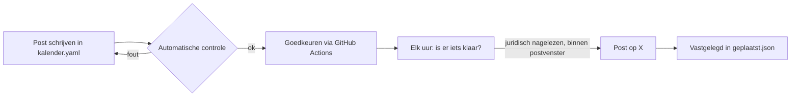

# Automatische promotie via X

Dit systeem plaatst posts op X volgens een vaste kalender, met controles die in de code zitten. Het doel: regelmatig en professioneel communiceren over Marketing Scan en Marketing Scan Genesis, zonder dat er ooit iets online gaat dat op een investering lijkt.

## Waarom zo streng

Marketing Scan Genesis is een voorverkoop van levenslange abonnementen (Genesis Pass, Genesis Agency en Supporter, zie `shared/genesis.json`). Het is **geen investering**: je krijgt geen aandelen, geen rendement, en de passes zijn soulbound, dus niet verhandelbaar. Elke post moet dat ook zo laten klinken. De controle blokkeert daarom alles wat op een investering, een effect of crypto-speculatie lijkt.

## Categorieën

| Categorie | Waarover | Verplicht |
|---|---|---|
| `product` | de scan zelf | mag niet over Genesis, passes, wallets of de voorverkoop gaan |
| `genesis` | de Genesis Pass, de voorverkoop, de prijsladder, de Genesis-muur | "Geen investering" (+ "Nog geen verkoop") |
| `uitleg` | hoe het werkt: wallet, soulbound, geld terug, transparantie | idem |
| `transparantie` | cijfers en stand van zaken | idem |
| `verkoop` | directe koopoproepen | kan pas als de verkoop live is, met link naar de voorwaarden |

Een post in een andere categorie die toch Genesis-woorden bevat (pass, wallet, Solana, levenslang, ...) krijgt dezelfde verplichtingen en hetzelfde juridisch slot.

## Wat de controle blokkeert

Elke post wordt gecontroleerd bij het schrijven (workflow "Controle"), bij het goedkeuren en opnieuw vlak voor het posten.

- **Investeringstaal**, in het Nederlands en het Engels: investeren, investering, belegging, invest, investor; aandelen, shares, equity, mede-eigenaar, co-owner; rendement, return, ROI, APY, APR, yield, winst, profit, dividend; waardering, valuation, "meer waard", "stijgt in waarde", value going up; doorverkopen, resell, flip, verhandelbaar, secondary market, speculatie; beursnotering.
- **Beloftes:** gegarandeerd, guaranteed, "zonder risico", passief inkomen, "10x", "100x", "x keer je geld".
- **Crypto-hype en crypto-verkooptermen:** moon, lambo, pump, wagmi, ape in, hodl, presale, ICO, IDO, token sale, airdrop, whitelist, cashtags zoals `$MSGEN`. Het woord "voorverkoop" mag wel.
- **Tijdsdruk:** laatste kans, nu of nooit, fomo, haast je, op is op, ...
- **Ontkennen mag, maar enkel vlak ervoor:** "Geen investering", "not an investment", "niet verhandelbaar", "geen speculatie" en "geen aandelen" zijn toegestaan. "Geen gedoe, wel rendement" blijft geblokkeerd.
- **Feiten over de prijsladder mogen wel:** "De prijs stijgt per 50 verkochte passes" en "Vroeger instappen is goedkoper" gaan over de prijs die je betaalt, niet over een doorverkoopwaarde.
- **Zolang de verkoop niet live is:** elke Genesis-post vermeldt letterlijk "Nog geen verkoop", en koopoproepen zijn verboden ("koop nu", "claim je pass", "bestel nu", "word supporter", "buy now", "mint now", "de voorverkoop is open", ...).
- **Altijd:** enkel links naar toegelaten domeinen, max 280 tekens zoals X ze telt (een link telt als 23), max 2 hashtags. Passnummers zoals `#001` tellen niet als hashtag.

De controles vangen de klassieke fouten op. Ze vervangen geen juridisch nazicht.

## Twee sloten

1. **Juridisch nazicht.** Productposts kunnen meteen na goedkeuring. Alle andere posts (en elke post met Genesis-woorden) blijven op "wacht op juridisch nazicht" staan tot `offer.legalReviewDone` op `true` staat. Doe dat pas als de rechtsvorm vastligt en de site en de posts nagelezen zijn.
2. **Verkoop.** De verkoop is pas "live" als `offer.verkoopActief` **en** `offer.legalReviewDone` allebei `true` zijn. Vanaf dan:
   - kan categorie `verkoop`, en enkel daar mogen koopoproepen staan;
   - moet elke verkooppost een link naar de voorwaarden bevatten (`{voorwaarden}`);
   - is "Nog geen verkoop" niet meer verplicht: de controle waarschuwt waar het nog staat.

## Instellingen (`marketing/x/config.json`)

| Sleutel | Nu | Betekenis |
|---|---|---|
| `offer.verkoopActief` | `false` | De verkoop is open. Hou dit gelijk met `verkoopActief` in `shared/genesis.json`. |
| `offer.legalReviewDone` | `false` | Site en posts zijn juridisch nagelezen. |
| `offer.required` | `Geen investering` | Verplichte vermelding in elke Genesis-post. |
| `offer.noticeWhenNotLive` | `Nog geen verkoop` | Verplichte vermelding zolang de verkoop niet live is. |
| `offer.voorwaardenUrl` | `https://community.marketingscan.be/voorwaarden` | Link voor `{voorwaarden}`, verplicht in verkoopposts. |
| `paused` | `false` | `true` zet alles in droogtest. |
| `links.site`, `links.scan` | | Basisadressen. `{genesis}` en `{transparantie}` volgen uit `links.site`. |
| `links.allowedDomains` | | Domeinen waarnaar een post mag linken. |

Placeholders in de kalender: `{site}`, `{scan}`, `{genesis}` (= `{site}/genesis`), `{transparantie}` (= `{site}/transparantie`) en `{voorwaarden}`.

## Wekelijkse transparantie-update

Elke maandag vult het sjabloon `transparantie-wekelijks` de cijfers in uit `marketing/x/data/cijfers.json`:

| Veld | Variabele | Opmerking |
|---|---|---|
| `bijgewerkt` | | Datum van je laatste update. Ouder dan 8 dagen: de post blijft geblokkeerd. |
| `passesGeclaimd` | `{passes}` | 0 tot 250 |
| `agencyGeclaimd` | `{agency}` | 0 tot 25 |
| `supporters` | `{supporters}` | |
| `opgehaaldEur` | `{opgehaald}` | in euro, richting het doel van €50.000 |
| `wekelijkseGebruikers` | `{gebruikers}` | |
| `wachtlijst` | `{wachtlijst}` | optioneel; met Supabase-sleutels wordt het echte aantal opgehaald |
| `stand` | `{stand}` | korte stand van zaken in eigen woorden |

Een ontbrekend of onmogelijk cijfer (bv. 251 passes) blokkeert de post. De vrije tekst in `stand` gaat door dezelfde controle als elke post. Tel enkel echte verkoop mee, geen testnet.

## Eenmalige installatie

### 1. X API

1. Maak op [developer.x.com](https://developer.x.com) een project en een app aan met het account van Marketing Scan.
2. Zet de app-rechten op **Read and Write**.
3. Laad krediet op (pay-per-use). Richtprijs oktober 2026: $0,015 per post, $0,20 per post met een link. De kalender (14 posts over 7 weken) kost zo ongeveer $2,25, plus $0,20 per wekelijkse update.
4. Genereer de **API Key en Secret** en daarna, met het Marketing Scan-account, de **Access Token en Secret** (OAuth 1.0a, user context).

### 2. GitHub

Op GitHub: **Settings > Secrets and variables > Actions**.

| Soort | Naam | Waarde |
|---|---|---|
| Secret | `X_API_KEY` | API Key |
| Secret | `X_API_SECRET` | API Key Secret |
| Secret | `X_ACCESS_TOKEN` | Access Token |
| Secret | `X_ACCESS_SECRET` | Access Token Secret |
| Secret (optioneel) | `SUPABASE_URL`, `SUPABASE_SECRET_KEY` | voor het live aantal op de wachtlijst |
| Variable | `X_POSTING_ENABLED` | `true` om echt te posten. Zolang dit ontbreekt: droogtest. |

Het automatisch posten draait enkel vanaf de hoofdbranch (`master`). Merge deze branch dus eerst.

## Dagelijks gebruik

1. **Post schrijven:** open `marketing/x/kalender.yaml` op GitHub (potloodje), voeg een post toe en bewaar. De workflow "Controle" meldt meteen of de post door de controle komt. Lokaal: `npm run x:lint`.
2. **Goedkeuren:** Actions > **X: post goedkeuren** > Run workflow > id invullen > goedkeuren. De goedkeuring is gekoppeld aan de exacte tekst: pas je de tekst nadien aan, dan vervalt ze.
3. **Planning bekijken:** lokaal `npm run x:plan`, of de logs van "X: automatisch posten" (elke run toont wat klaar is en waarom iets wacht).
4. **Elke week:** werk `marketing/x/data/cijfers.json` bij en keur het sjabloon `transparantie-wekelijks` één keer goed.

Er wordt enkel gepost tussen 08:00 en 21:00 (Brusselse tijd), met minstens 2 uur tussen twee posts en max 2 posts per dag. Elke geplaatste post komt met link en tijdstip in `marketing/x/state/geplaatst.json`.

### Noodstop

- Alles meteen stilleggen: zet de variabele `X_POSTING_ENABLED` op `false`, of zet `"paused": true` in `marketing/x/config.json`.
- Eén post tegenhouden: Actions > X: post goedkeuren > actie **intrekken**.

## Wanneer de verkoop start

Pas als de boekhouder de rechtsvorm (eenmanszaak of BV) heeft vastgelegd en de verkoop op de site echt open is:

1. Zet `offer.legalReviewDone` op `true` zodra site en posts nagelezen zijn. Genesis-posts met "Nog geen verkoop" kunnen dan al de deur uit.
2. Zet `offer.verkoopActief` op `true` op het moment dat de verkoop opent, samen met `verkoopActief` in `shared/genesis.json`.
3. Controleer dat `offer.voorwaardenUrl` naar de gepubliceerde voorwaarden wijst.
4. Haal "Nog geen verkoop" uit de posts en het sjabloon die nog moeten komen (de controle waarschuwt), en schrijf koopoproepen enkel in categorie `verkoop`, met `{voorwaarden}` en "Geen investering".
